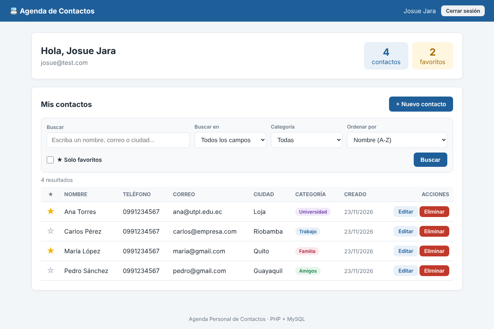
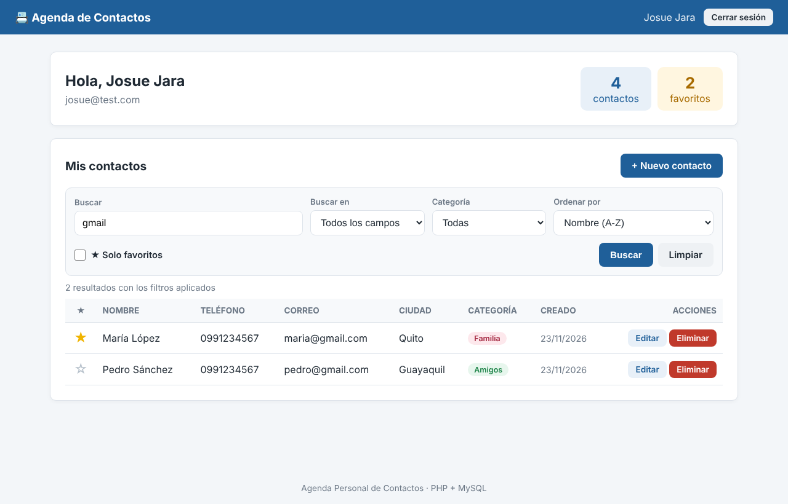
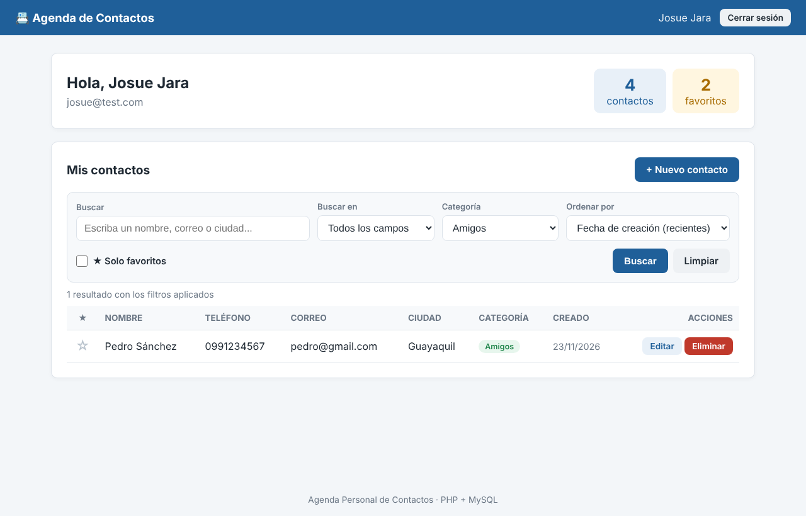
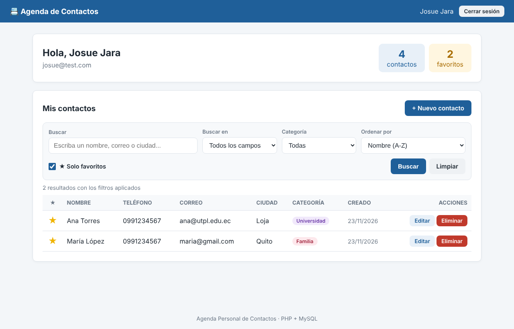
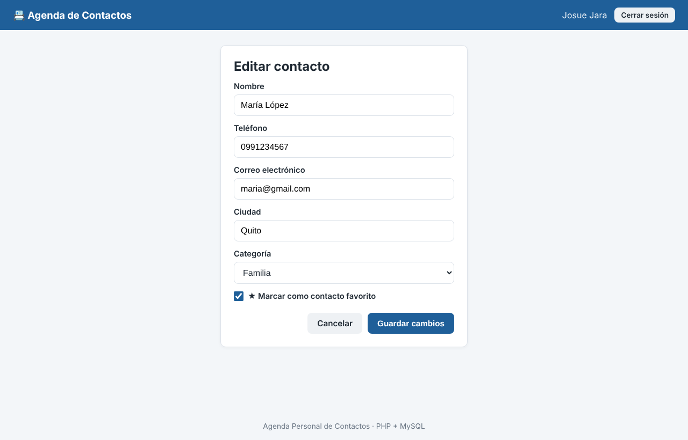

# Agenda Personal de Contactos con Autenticación en PHP

Aplicación web desarrollada en **PHP** y **MySQL** que permite a los usuarios registrarse, iniciar sesión y administrar su propia agenda de contactos. El sistema garantiza que solo los usuarios autenticados accedan a la aplicación y que cada uno vea y gestione **únicamente sus propios contactos**.

> Actividades: [ACDB1-35%] Foro y [APEB1-30%] Despliegue y Mejoras de una Aplicación Web en un Hosting Gratuito – Desarrollo Web (UTPL)
> Autor: **Josue Martin Jara Panchez**
> Universidad Técnica Particular de Loja – Tecnologías de la Información

## 🌐 URL pública

**http://agendajosue.byethost3.com**

Aplicación publicada en el hosting gratuito **ByetHost** (Apache + PHP 8.4 + MySQL), con la base de datos creada a partir de `database/agenda_contactos_hosting.sql`.

## 📸 Capturas de pantalla

| Panel con categorías y favoritos | Búsqueda por correo |
|---|---|
|  |  |

| Orden por fecha + filtro por categoría | Solo favoritos |
|---|---|
|  |  |

| Formulario con categoría y favorito |
|---|
|  |

---

## 1. Descripción del proyecto

| Módulo | Funcionalidad |
|---|---|
| **Registro** | Alta de nuevos usuarios, validación de correo único y almacenamiento de la contraseña cifrada con `password_hash()`. |
| **Inicio de sesión** | Formulario de correo y contraseña, verificación con `password_verify()`, creación de sesión y mensajes de error genéricos. |
| **Panel principal** | Página privada que muestra el nombre, el correo del usuario, totales de contactos y favoritos, y la lista de sus contactos con búsqueda, filtros y ordenamiento. |
| **Gestión de contactos** | Registrar, editar y eliminar contactos (con página de confirmación antes de eliminar), asignar categoría y marcar favoritos. |
| **Cierre de sesión** | Destrucción completa de la sesión y de su cookie. |

## 2. Mejoras respecto a la versión anterior (v2)

Se implementaron **las cuatro mejoras** propuestas:

| Mejora | Qué se hizo | Archivos |
|---|---|---|
| **A. Búsqueda de contactos** | Búsqueda en el **servidor** por nombre, correo o ciudad (o los tres a la vez) con un selector "Buscar en". Usa `LIKE` con parámetros preparados y escapa los comodines `%` y `_` para buscar el texto literal. La búsqueda queda en la URL, así que se puede recargar o compartir. | `panel.php`, `includes/functions.php` |
| **B. Ordenamiento** | Orden por **nombre**, **ciudad** y **fecha de creación**, ascendente o descendente. Se agregó la columna `fecha_creacion` (`DEFAULT CURRENT_TIMESTAMP`). El `ORDER BY` sale de una **lista blanca** en el servidor; un valor manipulado en la URL vuelve al orden predeterminado. | `panel.php`, `includes/functions.php`, SQL |
| **C. Categorías** | Nueva tabla `categorias` (Familia, Amigos, Trabajo, Universidad, Otro) relacionada con `contactos` mediante la llave foránea `id_categoria`. Cada contacto **pertenece a una categoría** (campo obligatorio y validado contra la base). Se muestra como etiqueta de color y se puede filtrar por ella. | `includes/contacto_form.php`, `contacto_crear.php`, `contacto_editar.php`, `panel.php`, SQL |
| **D. Contactos favoritos** | Campo `favorito` (Sí/No). Se marca desde el formulario o con la **estrella** de la tabla (POST con token CSRF, solo sobre contactos propios). La casilla **"Solo favoritos"** muestra únicamente los favoritos. | `contacto_favorito.php`, `panel.php`, `includes/contacto_form.php` |

**Otros cambios:**
- Los filtros se aplican solos al cambiar un selector (evento `change` en JavaScript) y se conservan al marcar o desmarcar una estrella.
- Contador de favoritos en el panel; la página de eliminación muestra también la categoría y si es favorito.
- Configuración de conexión preparada para el hosting (`config/local.example.php`) y script SQL específico para importar en phpMyAdmin.
- Script de migración para actualizar una base de la versión anterior **sin perder datos**.

## 3. Tecnologías utilizadas

- **PHP 8.1+** (PDO, sesiones nativas, `password_hash` / `password_verify`)
- **MySQL 8.x** o **MariaDB 10.x**
- **HTML5** y **CSS3** (diseño responsivo, sin frameworks)
- **JavaScript** (eventos `submit`, `input` y `DOMContentLoaded` para validación y búsqueda en el cliente)
- **Apache** (XAMPP en local, ByetHost en producción)
- **Git y GitHub** (control de versiones)

## 4. Requisitos para su ejecución

- XAMPP (Apache + PHP 8.1 o superior) o cualquier servidor con PHP 8.1+
- Extensión `pdo_mysql` habilitada (viene activa en XAMPP)
- MySQL 8.x o MariaDB 10.x
- Navegador web actualizado

## 5. Instalación local

1. **Copiar el proyecto** en la carpeta pública del servidor. Descargue el repositorio (botón **Code → Download ZIP**) y descomprímalo en `C:\xampp\htdocs\`, de modo que quede la ruta `C:\xampp\htdocs\agenda-contactos\`.

2. **Crear la base de datos.** Ejecutar el script `database/agenda_contactos.sql` desde MySQL Workbench, phpMyAdmin o la terminal:
   ```bash
   mysql -u root -p < database/agenda_contactos.sql
   ```
   > Si ya tenía la base de la versión anterior y quiere conservar sus datos, ejecute en su lugar `database/migracion_v1_a_v2.sql`.

3. **Configurar la conexión.** Los valores por defecto están en `config/database.php` (host `127.0.0.1`, puerto `3306`, usuario `root`, sin contraseña).
   Si su MySQL tiene contraseña, cree el archivo `config/local.php` (está excluido del repositorio en `.gitignore`):
   ```php
   <?php
   return ['db_pass' => 'contraseña_de_mysql'];
   ```

4. **Iniciar Apache** (y MySQL si usa el de XAMPP) desde el panel de control de XAMPP.

5. **Abrir en el navegador:** `http://localhost/agenda-contactos/`

## 6. Despliegue en hosting gratuito (ByetHost)

1. Crear una cuenta gratuita en [byet.host](https://byet.host/free-hosting) con un subdominio (por ejemplo `agendajosue.byethost3.com`) y activarla desde el correo.
2. En el panel de control (VistaPanel), abrir **MySQL Databases** y crear una base de datos. Anotar el host, nombre de la base, usuario y contraseña.
3. Abrir **phpMyAdmin**, seleccionar la base creada e importar `database/agenda_contactos_hosting.sql` (este script no incluye `CREATE DATABASE`, que el hosting no permite).
4. Subir el contenido del proyecto a la carpeta **`htdocs`** con el administrador de archivos o por FTP (FileZilla).
5. Crear `htdocs/config/local.php` a partir de `config/local.example.php` con los datos del paso 2:
   ```php
   <?php
   return [
       'db_host' => 'servidor_mysql_del_hosting',
       'db_name' => 'nombre_de_la_base',
       'db_user' => 'usuario_mysql',
       'db_pass' => 'contraseña_mysql',
   ];
   ```
6. Abrir la URL pública, registrar un usuario y probar todas las funciones.

## 7. Estructura del proyecto

```
agenda-contactos/
├── index.php                 # Redirige a login o panel según la sesión
├── registro.php              # Registro de usuarios
├── login.php                 # Inicio de sesión
├── logout.php                # Cierre de sesión
├── panel.php                 # Panel privado con la lista de contactos
├── contacto_crear.php        # Registrar contacto
├── contacto_editar.php       # Editar contacto
├── contacto_eliminar.php     # Confirmar y eliminar contacto
├── contacto_favorito.php     # Marcar / desmarcar favorito (mejora D)
├── config/
│   ├── database.php          # Conexión PDO
│   └── local.example.php     # Plantilla de credenciales (local / hosting)
├── includes/
│   ├── bootstrap.php         # Configuración segura de la sesión
│   ├── auth.php              # Login, verificación y cierre de sesión
│   ├── functions.php         # Escape XSS, CSRF, validaciones, mensajes
│   ├── contacto_form.php     # Formulario reutilizable
│   ├── header.php / footer.php
├── assets/
│   ├── css/styles.css
│   └── js/app.js             # Validación y filtros basados en eventos
├── docs/capturas/            # Capturas de pantalla
└── database/
    ├── agenda_contactos.sql          # Script completo (local)
    ├── agenda_contactos_hosting.sql  # Script para importar en el hosting
    └── migracion_v1_a_v2.sql         # Actualiza una base v1 sin perder datos
```

## 8. Seguridad implementada

| Requisito | Implementación |
|---|---|
| `password_hash()` | La contraseña se guarda cifrada con bcrypt (`PASSWORD_DEFAULT`); nunca en texto plano. |
| `password_verify()` | Compara la contraseña ingresada con el hash almacenado al iniciar sesión. |
| Validación en el servidor | Todos los formularios se validan en PHP (campos obligatorios, formato de correo y teléfono, longitudes, contraseña mínima de 8 caracteres con letras y números). |
| Sesión activa en páginas protegidas | `requerirLogin()` se ejecuta al inicio de `panel.php` y de todas las páginas de contactos; sin sesión redirige al login. La sesión expira tras 30 minutos de inactividad. |
| Acceso solo a contactos propios | Toda consulta usa `WHERE id = ? AND id_usuario = ?`, con `id_usuario` tomado de la **sesión**, nunca de la URL ni del formulario. Cambiar el `id` en la URL no permite ver, editar ni eliminar contactos ajenos. |
| Mensajes de error sin información sensible | El login responde siempre "Correo o contraseña incorrectos" (no revela si el correo existe) y los errores de base de datos se registran en el log, no se muestran. |
| Búsqueda y orden seguros | Los textos de búsqueda viajan como parámetros preparados; las columnas de búsqueda, el `ORDER BY` y la categoría se validan con listas blancas en el servidor. |
| Adicionales | Consultas preparadas con PDO (contra inyección SQL), `htmlspecialchars()` en toda la salida (contra XSS), token CSRF en los formularios, `session_regenerate_id()` al iniciar sesión, cookies `HttpOnly` y `SameSite=Strict`, eliminación solo por POST y `.htaccess` que bloquea el acceso directo a `config/`, `includes/` y `database/`. |

## 9. Autor

**Josue Martin Jara Panchez**
Estudiante de Tecnologías de la Información – Universidad Técnica Particular de Loja (UTPL)
Asignatura: Desarrollo Web
